# PromoQuoter: Service Breakdown

A complete walk-through of what the service does and how it works: architecture, data model, every endpoint, every business rule, the rules engine, sequence flows, concurrency and idempotency, error handling, logging, tests and known limits. It describes the code on `main`.

Diagrams use [Mermaid](https://mermaid.js.org/) and render on GitHub and in most Markdown viewers.

## Contents

1. [What the service is](#1-what-the-service-is)
2. [Technology and runtime](#2-technology-and-runtime)
3. [Architecture](#3-architecture)
4. [Data model](#4-data-model)
5. [API reference](#5-api-reference)
6. [Business rules](#6-business-rules)
7. [The rules engine](#7-the-rules-engine)
8. [Sequence flows](#8-sequence-flows)
9. [Concurrency and consistency](#9-concurrency-and-consistency)
10. [Idempotency](#10-idempotency)
11. [Validation catalogue](#11-validation-catalogue)
12. [Error handling](#12-error-handling)
13. [Logging and request ids](#13-logging-and-request-ids)
14. [Configuration](#14-configuration)
15. [Testing](#15-testing)
16. [Build, run, deploy and workflow](#16-build-run-deploy-and-workflow)
17. [Edge cases and known limits](#17-edge-cases-and-known-limits)
18. [Extending the service](#18-extending-the-service)

---

## 1. What the service is

PromoQuoter is a single-node Spring Boot REST service for a shop. It does three things:

1. **Catalogue.** Merchandisers create products (price, stock) and promotions (discount rules). Promotions can be deactivated, re-prioritised, re-segmented or deleted at runtime.
2. **Quote.** A client sends a cart and gets an itemised price: per line, the cart totals, and the ordered list of promotions that changed the price.
3. **Confirm.** A client confirms a cart. The service re-prices it, locks the stock rows, checks every line, decrements stock and stores an order, all in one transaction. A stock-out returns `409`. A retry with the same `Idempotency-Key` returns the original order and reserves nothing a second time.

Design goals that shaped the code:

- **Pluggable rules.** Promotions are Strategy objects, built by a Factory from stored definitions and run through an ordered Pipeline, with a Decorator producing the audit trail. A new promotion type means new classes, not changes to orchestration.
- **Correct money.** `BigDecimal` with two decimals, `HALF_UP`, never negative, lines always sum to the cart total.
- **Correct concurrency.** No overselling and no double reservation, proven by tests that fail when the lock is removed.
- **Testable.** The pricing engine has no Spring or JPA dependency.

## 2. Technology and runtime

| Concern | Choice |
|---|---|
| Language / runtime | Java 21 (builds on 17+), Spring Boot 3.5.16 |
| Web | Spring Web (MVC), Bean Validation |
| Persistence | Spring Data JPA / Hibernate 6, H2 in-memory |
| Schema | Generated by Hibernate at startup (`ddl-auto=create`), with a `CHECK (stock >= 0)` on `product` |
| Boilerplate | Lombok on classes, records for DTOs and value objects, hand-written mapping |
| Operations | Spring Boot Actuator, `health` endpoint only |
| Logging | SLF4J / Logback, custom `RequestLoggingFilter`, optional ECS JSON profile |
| Build | Maven wrapper, JaCoCo coverage gate (≥ 85 % lines on `verify`) |
| Container | Multi-stage Dockerfile (Temurin 21 JDK build, JRE run, non-root user) |
| Not used | Flyway, springdoc/OpenAPI, Micrometer Tracing (removed to keep dependencies lean), authentication |

Everything is in one Maven module under `com.promoquoter`.

## 3. Architecture

### 3.1 Package-by-feature

Each feature package owns its controller, service, entity and repository. Entities and repositories are package-private, so another feature can only reach them through a public service. Dependencies point one way:

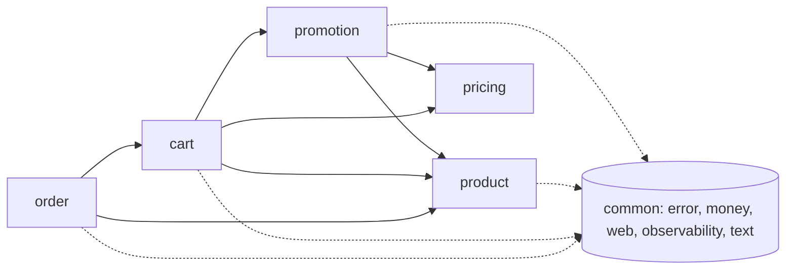

| Package | Responsibility | Public surface |
|---|---|---|
| `product` | Product entity, create / get / list, stock reservation | `ProductService`, `InventoryService`, `ProductController`, DTOs |
| `promotion` | Promotion entity, create / list / get / patch / delete, conversion to definitions | `PromotionService`, `PromotionController`, DTOs |
| `pricing` | The rules engine. **No Spring, no JPA** | `PricingEngine`, `PricingRule`, `RuleProvider`, `PromotionDefinition`, `PriceBreakdown` |
| `cart` | Cart request, normalisation, quoting | `CartNormalizer`, `QuoteService`, `CartController` |
| `order` | Confirm, idempotency, order storage and reads | `CheckoutService`, `OrderService`, `CheckoutController`, `OrderController` |
| `common` | Error model and handler, money, paging, request logging, text helpers | `ApiException`, `ErrorCode`, `Money`, `PageRequestFactory`, `RequestContext` |

### 3.2 Layers inside a feature

```
Controller  (HTTP, validation annotations, status codes)
   ↓
Service     (transactions, orchestration, error mapping)
   ↓
Repository  (Spring Data JPA)        Entity  (package-private)
```

Controllers return records (DTOs). Entities never leave their package.

### 3.3 Key classes

| Class | Role |
|---|---|
| `QuoteService` | Loads products and active promotions, hands them to `PricingEngine`. Read-only transaction |
| `CartNormalizer` | Merges duplicate lines, enforces the merged quantity cap, defaults the segment, sorts items by product id |
| `PricingEngine` | Entry point of the engine: factory → pipeline → context → breakdown |
| `PromotionRuleFactory` | Turns `PromotionDefinition`s into rules; filters by `active` and segment; fails at startup if a type has no provider |
| `PricingPipeline` | Sorts rules by stage, priority, creation time, id and runs them over one `PricingContext` |
| `AuditingRule` | Decorator around every rule; records which line each promotion changed and by how much |
| `PricingContext` / `PricedLine` | Mutable per-request state: running total per line, applied-promotion log |
| `Money` | Rounding (`HALF_UP`, scale 2) and percent / proportion helpers |
| `InventoryService` | Locks product rows in id order, checks all lines, decrements stock. Requires an existing transaction |
| `CheckoutService` | The confirm algorithm: idempotency record, reserve, price, save order, replay logic |
| `RequestFingerprint` | SHA-256 of the normalised cart; the idempotency "same request" test |
| `GlobalExceptionHandler` | Maps every exception to an RFC 7807 problem body with `code`, `requestId`, `errors[]` |
| `RequestLoggingFilter` / `RequestContext` | Assigns the request id, puts it in the logging context, logs start and completion |

## 4. Data model

The schema is generated from the JPA entities. Money columns are `DECIMAL(19,2)`, timestamps are UTC `Instant`s truncated to microseconds, ids are UUIDs.

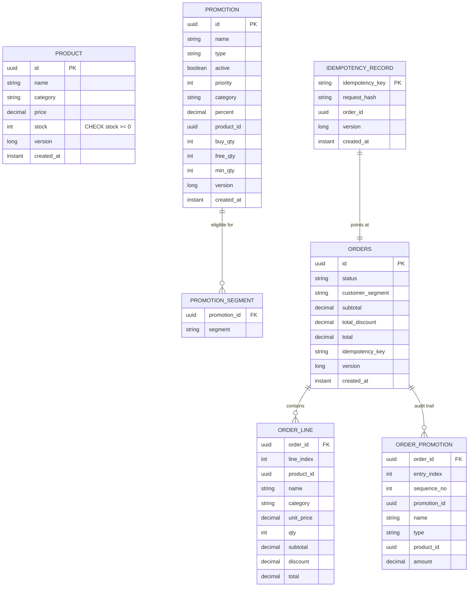

Design notes:

- **One `promotion` table for all types.** A `type` column discriminates; type-specific columns (`category`, `percent`, `product_id`, `buy_qty`, `free_qty`, `min_qty`) are nullable. Eligible segments live in `promotion_segment`; an empty set means "everyone".
- **Orders are snapshots.** `order_line` copies the product name, category and unit price; `order_promotion` copies the promotion name and type. Neither references `product` or `promotion` by foreign key, so history survives catalogue changes and promotion deletion.
- **`idempotency_record.idempotency_key` is the primary key.** That uniqueness is what makes concurrent duplicate requests safe (section 10). It does not have a foreign key to `orders`, because the record is inserted before the order within the same transaction.
- **`product.stock` has a database CHECK** as a last line of defence behind the lock and the in-code check.
- **`@Version`** columns exist on product, promotion, order and idempotency record for optimistic-lock protection on any path that does not take the row lock.
- **`ddl-auto=create`** rebuilds the schema on every start. That is fine for in-memory H2; a persistent database would need migrations (listed under "with more time").

## 5. API reference

Base path `/api/v1`. JSON only. Money is a string with exactly two decimals (`"12.50"`). Timestamps are ISO-8601 UTC. Every response carries `X-Request-Id`. Unknown JSON fields are rejected with `400 MALFORMED_REQUEST`.

| Method | Path | Success | Errors |
|---|---|---|---|
| POST | `/products` | `201` array of products | 400 |
| GET | `/products` | `200` page | 400 |
| GET | `/products/{id}` | `200` product | 400, 404 |
| POST | `/promotions` | `201` array of promotions | 400, 422 |
| GET | `/promotions` | `200` page | 400 |
| GET | `/promotions/{id}` | `200` promotion | 400, 404 |
| PATCH | `/promotions/{id}` | `200` promotion | 400, 404 |
| DELETE | `/promotions/{id}` | `204` | 400, 404 |
| POST | `/cart/quote` | `200` quote | 400, 404 |
| POST | `/cart/confirm` | `201` order (`Idempotent-Replayed: true` on a replay) | 400, 404, 409, 422 |
| GET | `/orders` | `200` page | 400 |
| GET | `/orders/{id}` | `200` order | 400, 404 |
| GET | `/actuator/health` | `200` `{"status":"UP"}` | n/a |

### 5.1 Products

`POST /products` takes an array of 1 to 100 products and saves them all or none.

```json
[{ "name": "Mug", "category": "kitchen", "price": "12.00", "stock": 50 }]
```

The category is trimmed and upper-cased (`" kitchen "` becomes `KITCHEN`). The response adds `id` and `createdAt`:

```json
{ "id": "…", "name": "Mug", "category": "KITCHEN", "price": "12.00", "stock": 50, "createdAt": "2026-10-28T08:00:00Z" }
```

`GET /products?category=kitchen&sort=price,desc&page=0&size=20` lists products. `category` is normalised the same way as on create.

### 5.2 Promotions

`POST /promotions` takes an array of 1 to 100 promotions of mixed types, discriminated by `type`. All or none are saved.

```json
[
  { "type": "PERCENT_OFF_CATEGORY", "name": "10% off kitchen", "category": "kitchen", "percent": 10 },
  { "type": "BUY_X_GET_Y", "name": "Mugs 2+1", "productId": "…", "buyQty": 2, "freeQty": 1, "eligibleSegments": ["VIP"] },
  { "type": "TIERED_BULK", "name": "5% off 10+", "productId": "…", "minQty": 10, "percent": 5, "priority": 3, "active": true }
]
```

Common optional fields: `priority` (default 0, lower runs first within its stage), `active` (default `true`), `eligibleSegments` (default empty, meaning everyone).

`GET /promotions?type=BUY_X_GET_Y&active=true` filters by type and active flag.

`PATCH /promotions/{id}` changes only the fields present:

```json
{ "name": "Renamed", "active": false, "priority": 1, "eligibleSegments": ["VIP"] }
```

- `eligibleSegments: []` opens the promotion to everyone.
- Rule parameters (`category`, `percent`, `productId`, `buyQty`, `freeQty`, `minQty`) cannot be patched. Sending them is a `400 MALFORMED_REQUEST` because unknown fields are rejected. To change a rule, delete it and create a new one.
- An empty body (`{}`) is a `400 VALIDATION_FAILED`.

`DELETE /promotions/{id}` removes the promotion. It affects only future quotes and confirms; stored orders keep their applied-promotion snapshot.

### 5.3 Cart quote and confirm

Both take the same body:

```json
{ "items": [{ "productId": "…", "qty": 3 }], "customerSegment": "REGULAR" }
```

`customerSegment` is optional (`REGULAR`, `VIP`, `EMPLOYEE`; default `REGULAR`; case-sensitive).

Quote response:

```json
{
  "customerSegment": "REGULAR",
  "lines": [{ "productId": "…", "name": "Mug", "category": "KITCHEN", "unitPrice": "12.00", "qty": 3,
              "subtotal": "36.00", "discount": "14.40", "total": "21.60" }],
  "appliedPromotions": [
    { "sequence": 1, "promotionId": "…", "name": "10% off kitchen", "type": "PERCENT_OFF_CATEGORY", "productId": "…", "amount": "3.60" },
    { "sequence": 2, "promotionId": "…", "name": "Mugs 2+1", "type": "BUY_X_GET_Y", "productId": "…", "amount": "10.80" }
  ],
  "subtotal": "36.00", "totalDiscount": "14.40", "total": "21.60"
}
```

Confirm returns the same shape plus `orderId`, `status` (`CONFIRMED`) and `createdAt`, with status `201`. It accepts an optional `Idempotency-Key` header (1 to 100 non-blank characters).

### 5.4 Orders

`GET /orders/{id}` returns the stored order exactly as it was confirmed. `GET /orders?sort=total,desc` pages through orders.

### 5.5 Paging and sorting

| Parameter | Rule |
|---|---|
| `page` | Zero-based, default 0, must be ≥ 0 |
| `size` | Default 20, must be ≥ 1, values above 100 are capped to 100 |
| `sort` | `field` or `field,asc` or `field,desc`. Anything else is `400 INVALID_SORT` |

Allowed sort fields: products `name`, `price`, `createdAt`; promotions `name`, `priority`, `createdAt`; orders `createdAt`, `total`. Default is `createdAt,desc`. `id` is always appended as a tie-breaker so paging is stable.

Page shape:

```json
{ "content": [ … ], "page": 0, "size": 20, "totalElements": 57, "totalPages": 3 }
```

## 6. Business rules

### Pricing

| # | Rule |
|---|---|
| BR1 | Line subtotal = unit price × quantity |
| BR2 | Rules run in stage order: `PERCENT_OFF_CATEGORY` (100), `BUY_X_GET_Y` (200), `TIERED_BULK` (300). Within a stage: `priority` ascending, then `createdAt`, then `id`. Each rule works on the running total left by earlier rules (discounts stack) |
| BR3 | A promotion takes part only if it is `active` and either has no segment list or lists the cart's segment |
| BR4 | `PERCENT_OFF_CATEGORY`: for each line whose category equals the promotion's, discount = running total × percent / 100 |
| BR5 | `BUY_X_GET_Y`: for the line of `productId`, free units = `floor(qty / (buyQty + freeQty)) × freeQty`; discount = running total × freeUnits / qty. Free units are valued at the already-discounted unit price. Free items are never added to the cart |
| BR6 | `TIERED_BULK`: for the line of `productId`, if `qty >= minQty`, discount = running total × percent / 100 |
| BR7 | Every discount is rounded `HALF_UP` to 2 decimals at the moment it is applied |
| BR8 | A discount is capped at the line's current running total, so a line never goes below `0.00` |
| BR9 | Cart `subtotal` = sum of line subtotals, `totalDiscount` = sum of line discounts, `total` = sum of line totals. Lines reconcile exactly with the cart |
| BR10 | An applied-promotion entry is recorded per (promotion, line) with a discount above `0.00`, in application order, numbered from 1. Promotions that change nothing are not listed |

### Cart input

| # | Rule |
|---|---|
| BR11 | `items` is non-empty with at most 100 entries; each `qty` is 1 to 1000; `productId` is required |
| BR12 | Duplicate `productId`s are merged (quantities summed). The merged quantity must also be at most 1000, otherwise `400` |
| BR13 | An unknown `productId` is `404 PRODUCT_NOT_FOUND`, listing every missing id |
| BR14 | A missing `customerSegment` is `REGULAR`; an unknown value is `400` |
| BR15 | Quote does not check stock |

### Confirm and stock

| # | Rule |
|---|---|
| BR16 | Confirm re-prices from current data. There is no quote token, so the price can differ from an earlier quote |
| BR17 | Products are locked with `SELECT … FOR UPDATE` in ascending id order. The stock check, the decrement and the order insert happen in one transaction |
| BR18 | If any line exceeds stock, the response is `409 INSUFFICIENT_STOCK` listing **every** short product (`productId`, `requested`, `available`). Nothing is reserved |
| BR19 | A lock timeout or optimistic-lock failure is `409 CONCURRENT_MODIFICATION` |

### Idempotency

| # | Rule |
|---|---|
| BR20 | `Idempotency-Key` is optional. When present it must be 1 to 100 non-blank characters, else `400 INVALID_IDEMPOTENCY_KEY` |
| BR21 | Same key and same normalised request: `201` with the stored order, header `Idempotent-Replayed: true`, no stock change |
| BR22 | Same key and a different request: `422 IDEMPOTENCY_KEY_REUSED` |
| BR23 | Concurrent requests with the same key: the primary key lets exactly one win; the others replay the winner's order |
| BR24 | Failed confirms are not recorded, so the same key can succeed later (for example after a restock) |
| BR25 | Keys are global (there is no authentication) and never expire |
| BR26 | Without a key, every confirm creates a new order |

### Catalogue

| # | Rule |
|---|---|
| BR27 | Batch creates are all-or-nothing and hold 1 to 100 items |
| BR28 | `BUY_X_GET_Y` and `TIERED_BULK` must reference an existing product, else `422 UNKNOWN_PRODUCT` listing each bad index. Category promotions are not checked against products |
| BR29 | Duplicate product names are allowed |
| BR32 | `GET /promotions/{id}` of an unknown id is `404 PROMOTION_NOT_FOUND` |
| BR33 | `PATCH` changes only `name`, `active`, `priority`, `eligibleSegments`; an empty body is `400` |
| BR34 | `DELETE` affects only future pricing; stored orders keep their snapshot |
| BR35 | Unknown JSON fields are `400 MALFORMED_REQUEST` |

### Paging

| # | Rule |
|---|---|
| BR30 | `page` ≥ 0, `size` 1 to 100 (larger capped) |
| BR31 | Sort fields are allow-listed per resource, else `400 INVALID_SORT` |

## 7. The rules engine

The `pricing` package is plain Java with no framework imports. It knows nothing about HTTP, JPA or Spring.

### 7.1 Patterns

| Pattern | Class | What it does |
|---|---|---|
| Strategy | `PricingRule` and `PercentOffCategoryRule`, `BuyXGetYRule`, `TieredBulkRule` | Each rule encapsulates one discount algorithm behind `stage()`, `definition()` and `apply(context)` |
| Pipeline / Chain | `PricingPipeline` | Sorts rules into a fixed order and passes the same `PricingContext` through each |
| Factory | `PromotionRuleFactory` with one `RuleProvider` per type | Builds a rule from a stored `PromotionDefinition`; filters by active flag and segment |
| Decorator | `AuditingRule` | Wraps each rule; compares line totals before and after and records the difference as an applied promotion |

### 7.2 Class diagram

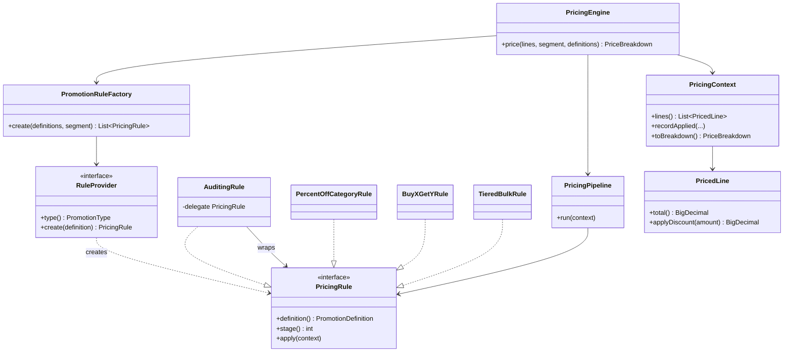

### 7.3 How a price is computed

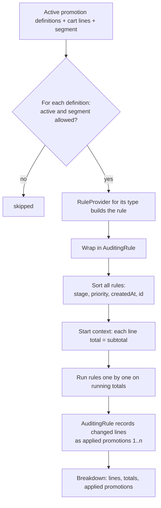

`PricedLine.applyDiscount` is the single place a discount touches a total. It rounds the requested amount, floors it at zero and caps it at the remaining line total, then returns what was really applied. That is how BR7 and BR8 hold no matter which rule runs.

### 7.4 Worked examples

All use a Mug at `12.00` in category `KITCHEN`.

**Example 1: the headline case.** 3 mugs, promotions "10% off kitchen" and "Mugs buy 2 get 1".

| Step | Calculation | Running total |
|---|---|---|
| Subtotal | 12.00 × 3 | 36.00 |
| Stage 100, 10% category | 36.00 × 10 / 100 = 3.60 | 32.40 |
| Stage 200, buy 2 get 1 | free units = floor(3 / 3) × 1 = 1; 32.40 × 1 / 3 = 10.80 | 21.60 |
| Result | total discount 14.40 | **21.60** |

Applied promotions: `#1 10% off kitchen 3.60`, `#2 Mugs 2+1 10.80`.

**Example 2: more free units.** 7 mugs, buy 2 get 1, no other promotions. Subtotal 84.00. Free units = floor(7 / 3) × 1 = 2. Discount = 84.00 × 2 / 7 = 24.00. Total **60.00**.

**Example 3: three stages.** 10 mugs, 10 % category, then a tiered 5 % for 10 or more. Subtotal 120.00. Stage 100 takes 12.00, leaving 108.00. Stage 300 takes 108.00 × 5 / 100 = 5.40, leaving **102.60**.

**Example 4: same stage, priorities.** 1 mug, "A" 10 % priority 1 and "B" 20 % priority 2, both category promotions. A runs first: 1.20, leaving 10.80. B takes 10.80 × 20 / 100 = 2.16, leaving **8.64**. Swapping the priorities swaps the order and the individual amounts, not the rules.

**Example 5: rounding.** 3 items at `9.99`, one 33.33 % category promotion. Subtotal 29.97. Discount = 29.97 × 33.33 / 100 = 9.989001, rounded `HALF_UP` to 9.99. Total **19.98**.

**Example 6: the cap.** 3 mugs, two 100 % category promotions. The first takes everything (36.00). The second computes 0.00 on a zero total, so it changes nothing and is **not listed**. Total **0.00**, never negative.

**Example 7: nothing applies.** One lamp, with a kitchen promotion and a mug promotion. No line changes, so `appliedPromotions` is empty and total equals subtotal.

**Example 8: segments.** A 50 % VIP-only promotion: a `REGULAR` cart is untouched; a `VIP` cart gets it.

## 8. Sequence flows

### 8.1 Create products

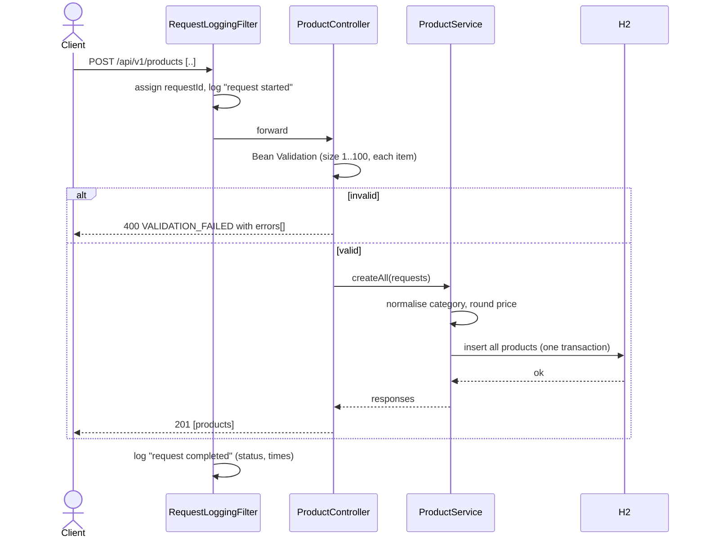

### 8.2 Create promotions

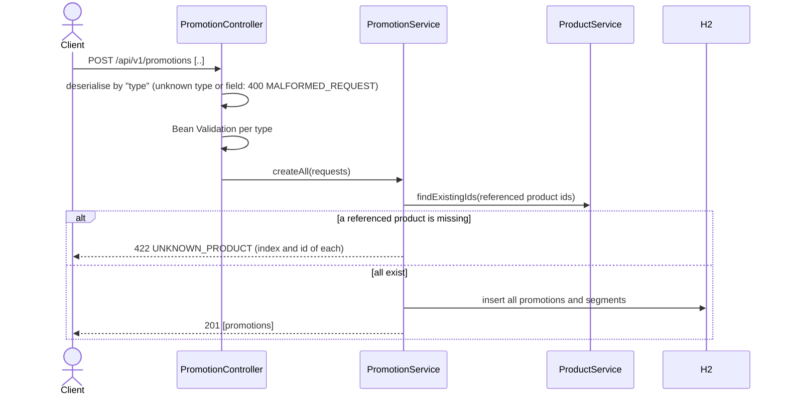

### 8.3 Quote

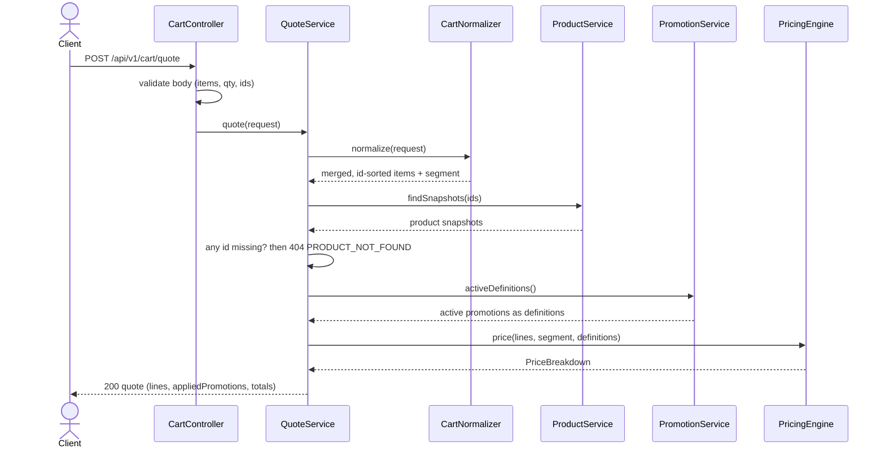

Nothing is written, and stock is not consulted.

### 8.4 Confirm: the normal path

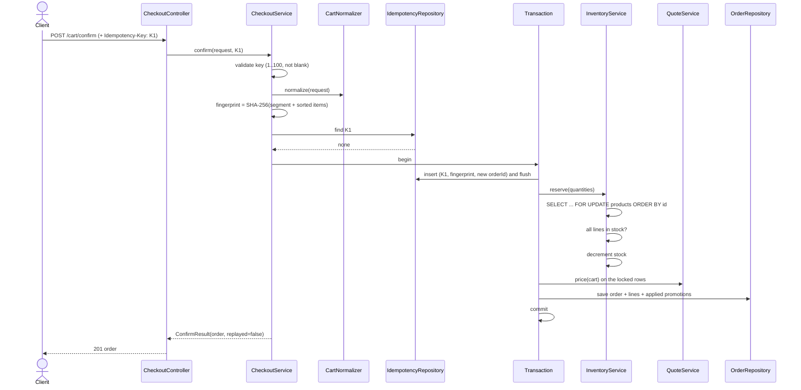

Without an `Idempotency-Key` the same flow runs with the idempotency steps skipped.

### 8.5 Confirm: stock-out

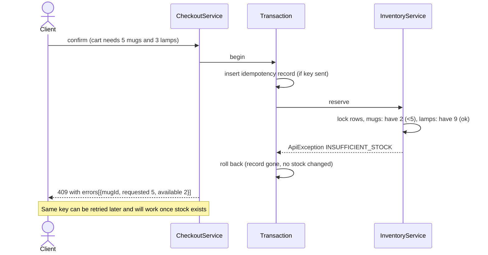

All shortages are collected before failing, so the client sees every problem in one response.

### 8.6 Confirm: idempotent replay and key reuse

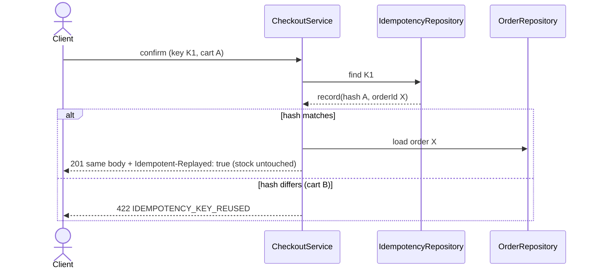

### 8.7 Confirm: two requests with the same key at once

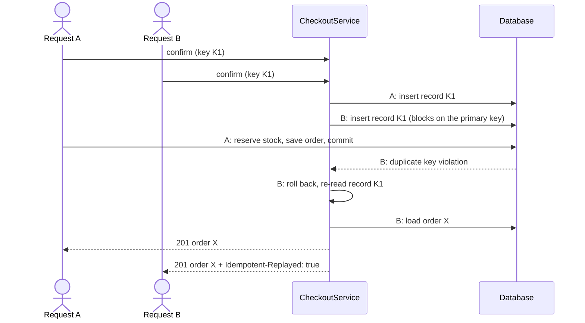

Stock is reserved exactly once. If A had failed instead (for example a stock-out), its transaction would roll back, B's insert would succeed and B would run its own attempt.

### 8.8 Many shoppers, limited stock

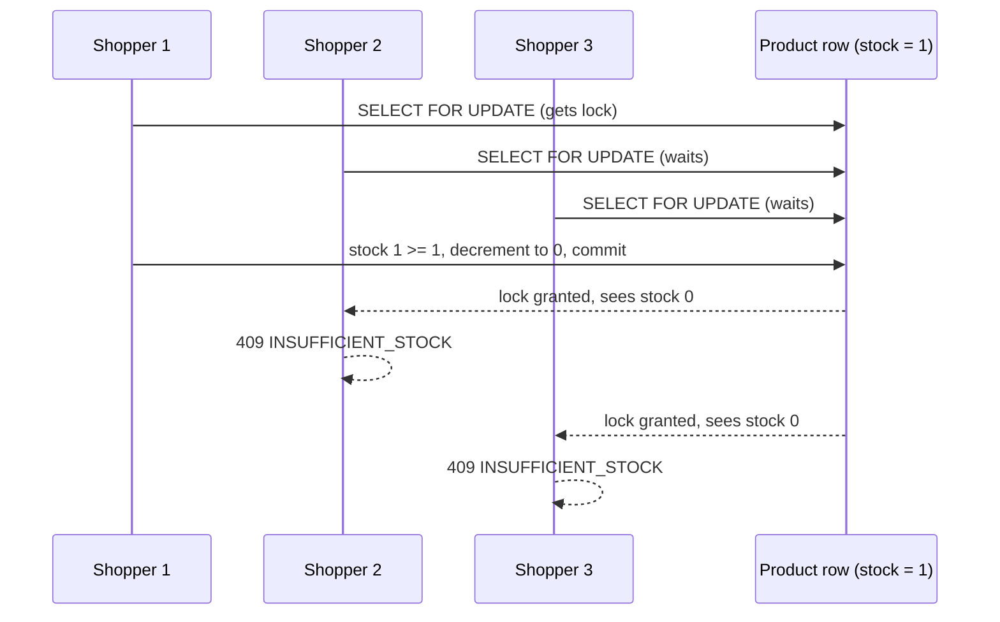

### 8.9 Managing a promotion at runtime

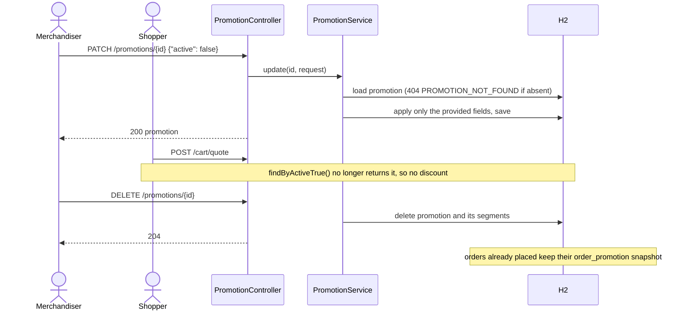

### 8.10 Error handling

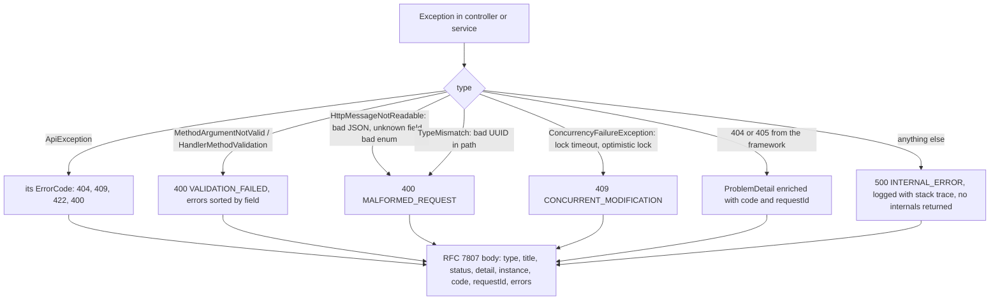

### 8.11 Request lifecycle and logging

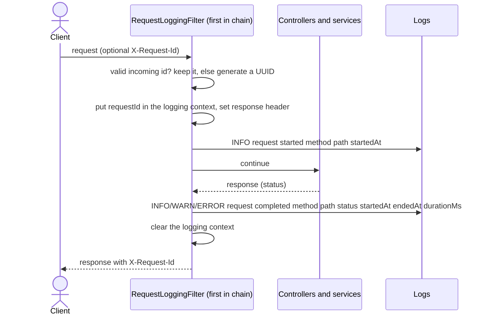

## 9. Concurrency and consistency

### 9.1 The mechanism

| Layer | Mechanism | Protects against |
|---|---|---|
| Row lock | `@Lock(PESSIMISTIC_WRITE)` query `lockAllByIdOrderById` → `SELECT … FOR UPDATE … ORDER BY id` | Two confirms reading the same stock and both decrementing it |
| Lock order | One query, ids sorted ascending | Deadlock when carts share products in different orders |
| In-code check | `InventoryService.rejectShortages` after locking | Reserving more than is on hand |
| Database check | `CHECK (stock >= 0)` | Any bug or manual write that would make stock negative |
| `@Version` | Optimistic version on product, promotion, order, idempotency record | Stale writes on any path that does not take the row lock |
| Lock timeout | H2 `LOCK_TIMEOUT=10000` ms; failure maps to `409 CONCURRENT_MODIFICATION` | A request hanging forever behind a stuck lock |
| Single transaction | Idempotency record, reservation, pricing and order are committed or rolled back together | Half-done confirms |

### 9.2 Why pricing happens after locking

`QuoteService.price` runs inside the same transaction, after the product rows are locked. The price, name and category used for the order are therefore read from the rows that were just locked and cannot change underneath the request.

### 9.3 What the tests prove

`ConcurrentCheckoutIT` runs real threads against the real database:

| Scenario | Expected result |
|---|---|
| 20 threads, 5 units of stock | exactly 5 orders, 15 get `409`, final stock 0 |
| Multi-product carts where one product is short | all-or-nothing: no partial reservation |
| 10 threads, same `Idempotency-Key` | one order, stock decremented once, all callers get that order |
| Opposite lock orders on two products | no deadlock |

As a check on the tests themselves, replacing `PESSIMISTIC_WRITE` with no lock made 3 of the 6 fail (overselling and partial reservation). With the lock restored they pass.

## 10. Idempotency

### 10.1 State table

| Situation | Result |
|---|---|
| No `Idempotency-Key` | New order every time |
| Key is blank or over 100 characters | `400 INVALID_IDEMPOTENCY_KEY` |
| New key | Order placed; record stored |
| Known key, same normalised cart and segment | `201`, stored order, `Idempotent-Replayed: true`, no stock change |
| Known key, different cart or segment | `422 IDEMPOTENCY_KEY_REUSED` |
| Key whose first attempt failed (stock-out, unknown product) | Nothing stored, so a retry runs normally |
| Two simultaneous requests with the same key | One wins; the other replays the winner |

### 10.2 What "same request" means

`RequestFingerprint` hashes `segment;productId:qty,productId:qty,…` using the **normalised** cart: duplicate lines merged, items sorted by product id, segment defaulted. The same cart written differently (items reordered, a product split across two lines, segment omitted instead of `REGULAR`) therefore counts as the same request.

### 10.3 Why the record is inserted first

The record and the order get a pre-generated `orderId`. Inserting the record first, inside the confirm transaction, means the database's primary-key uniqueness decides the race before any stock moves. A losing request waits for the winner, hits the duplicate key, rolls back (so it has reserved nothing) and answers with the winner's order.

### 10.4 Limits

Keys never expire and are global (no authentication). A client that retries a confirm **without** a key can create two orders; that is by design.

## 11. Validation catalogue

| Field | Rule |
|---|---|
| Product `name` | Not blank, ≤ 200 characters (trimmed) |
| Product `category` | Not blank, ≤ 100 characters, normalised to trimmed upper case |
| Product `price` | Required, > 0, ≤ 10 integer digits and 2 fraction digits. The cap guarantees a cart of 100 lines × 1000 units cannot overflow `DECIMAL(19,2)` |
| Product `stock` | Required, ≥ 0 |
| Promotion `name` | Not blank, ≤ 200 |
| Promotion `priority` | Optional integer |
| Promotion `eligibleSegments` | Optional set of `REGULAR` / `VIP` / `EMPLOYEE` |
| `PERCENT_OFF_CATEGORY` | `category` not blank; `percent` > 0, ≤ 100, ≤ 2 fraction digits |
| `BUY_X_GET_Y` | `productId` required and must exist; `buyQty` and `freeQty` each 1 to 1000 |
| `TIERED_BULK` | `productId` required and must exist; `minQty` 2 to 1000; `percent` > 0, ≤ 100 |
| Promotion patch | `name` not blank if present, ≤ 200; `priority` within ±1,000,000; at least one field |
| Batch arrays | 1 to 100 items |
| Cart `items` | 1 to 100 entries; `productId` required; `qty` 1 to 1000; merged quantity ≤ 1000 |
| `Idempotency-Key` | 1 to 100 non-blank characters |
| `page` / `size` / `sort` | See [5.5](#55-paging-and-sorting) |
| Any body | No unknown JSON fields |

Validation errors list `{field, message}` pairs sorted by field, with array indexes in the path (`[0].price`, `items[2].qty`).

## 12. Error handling

All errors are `application/problem+json` (RFC 7807) with extra members `code`, `requestId` and, where useful, `errors`.

```json
{
  "type": "urn:promoquoter:error:insufficient-stock",
  "title": "Insufficient stock",
  "status": 409,
  "detail": "Not enough stock for 1 product(s)",
  "instance": "/api/v1/cart/confirm",
  "code": "INSUFFICIENT_STOCK",
  "requestId": "0b2c8c1e-6a3e-4f3c-9d0e-2d4a1f7c9b11",
  "errors": [{ "productId": "…", "requested": 5, "available": 2 }]
}
```

| Code | Status | When |
|---|---|---|
| `VALIDATION_FAILED` | 400 | Bean Validation failure, bad paging values, empty patch, merged quantity over 1000 |
| `MALFORMED_REQUEST` | 400 | Unreadable JSON, wrong types, unknown field, unknown enum value or promotion `type`, malformed UUID in the path |
| `INVALID_SORT` | 400 | Sort field or direction not allowed |
| `INVALID_IDEMPOTENCY_KEY` | 400 | Key blank or over 100 characters |
| `PRODUCT_NOT_FOUND` | 404 | Unknown product id (path or cart) |
| `PROMOTION_NOT_FOUND` | 404 | Unknown promotion id |
| `ORDER_NOT_FOUND` | 404 | Unknown order id |
| `INSUFFICIENT_STOCK` | 409 | Stock-out on confirm; `errors[]` has `productId`, `requested`, `available` |
| `CONCURRENT_MODIFICATION` | 409 | Lock timeout or optimistic-lock failure; the client may retry |
| `UNKNOWN_PRODUCT` | 422 | A promotion references a product that does not exist |
| `IDEMPOTENCY_KEY_REUSED` | 422 | Key reused with a different request |
| `INTERNAL_ERROR` | 500 | Anything unexpected; details logged, never returned |

Framework-generated errors (unknown route `404`, wrong method `405`) go through the same handler so they also carry `code` and `requestId`.

## 13. Logging and request ids

`RequestLoggingFilter` runs first in the filter chain.

- **Request id.** An incoming `X-Request-Id` is reused if it is 1 to 64 characters of letters, digits, `.`, `_` or `-`. Otherwise a UUID is generated. Restricting the characters stops log injection through the header. The id is stored in the logging context under `requestId`, echoed in the `X-Request-Id` response header and added to every error body.
- **Per request.** A `request started` line, then a `request completed` line with method, path, status, `startedAt`, `endedAt` and `durationMs`. Completion is INFO for 1xx to 3xx, WARN for 4xx and ERROR for 5xx. The context is cleared afterwards so ids never leak between requests on a reused thread.
- **Business events.** INFO when an order is confirmed or replayed; WARN for `409` and `422` outcomes; ERROR with a stack trace for unexpected failures. Request bodies are never logged.

Plain-text pattern: `%5p [%X{requestId:-}]` follows the level, so a line looks like:

```
INFO [0b2c8c1e-6a3e-4f3c-9d0e-2d4a1f7c9b11] … : request started method=POST path=/api/v1/cart/confirm startedAt=2026-10-28T08:15:02.113Z
INFO [0b2c8c1e-…] … : Order 4f1c… confirmed, total 21.60
INFO [0b2c8c1e-…] … : request completed method=POST path=/api/v1/cart/confirm status=201 startedAt=… endedAt=… durationMs=18
```

The `json` Spring profile switches the console to ECS structured JSON, where `requestId` appears as a field.

## 14. Configuration

`src/main/resources/application.yml`:

| Setting | Value | Why |
|---|---|---|
| `spring.datasource.url` | `jdbc:h2:mem:promoquoter;DB_CLOSE_DELAY=-1;LOCK_TIMEOUT=10000` | In-memory database that survives connection churn; 10 s lock wait |
| `spring.jpa.open-in-view` | `false` | No lazy loading in the web layer; transactions end in services |
| `spring.jpa.hibernate.ddl-auto` | `create` | Hibernate builds the schema at startup |
| `spring.jackson.deserialization.fail-on-unknown-properties` | `true` | Reject typos and unsupported fields |
| `management.endpoints.web.exposure.include` | `health` | Only the health endpoint is exposed |
| `logging.pattern.level` | `%5p [%X{requestId:-}]` | Request id in every log line |

`application-json.yml` (profile `json`) enables ECS structured logging.

## 15. Testing

278 tests; line coverage 99.0 %, branch coverage 94.1 %. `./mvnw verify` fails if line coverage drops below 85 %. The HTML report is at `target/site/jacoco/index.html`.

| Level | Classes | Covers |
|---|---|---|
| Unit (no Spring) | `MoneyTest`, `CategoriesTest`, `PageRequestFactoryTest`, `CartNormalizerTest`, `ProductTest`, `PromotionTest`, `OrderTest`, `RequestFingerprintTest`, `PricingContextTest`, `PricingEngineTest`, `PricingPipelineTest`, `PromotionRuleFactoryTest`, `AuditingRuleTest`, rule tests under `pricing/rules` | Rounding, caps, thresholds, ordering and tie-breaks, stacking, eligibility, fail-fast wiring, decorator audit, merging of duplicate lines, stock decrement guard |
| Integration (`@SpringBootTest` + MockMvc + H2) | `ProductControllerIT`, `ProductStockConstraintIT`, `InventoryServiceIT`, `PromotionControllerIT`, `PromotionManagementIT`, `CartQuoteIT`, `CheckoutIT` (including order reads), `OrderPersistenceIT`, `GlobalExceptionHandlerIT`, `RequestLoggingIT`, `ApplicationIT` | Every endpoint's success path and every error code, paging and filters, idempotent replay and key reuse, stock visible through `GET /products/{id}`, request-id header and log output, strict JSON, numeric caps |
| Concurrency | `ConcurrentCheckoutIT` | Overselling, partial reservation, same-key races, lock-order deadlocks |

Support code: `IntegrationTest` (meta-annotation), `TestDatabase` (clean tables, set/read stock, direct counts) and `ApiFixtures`. `ErrorProbeController` exists in test sources only, to trigger a 500 and verify it is sanitised.

```bash
./mvnw test      # all tests
./mvnw verify    # tests, JaCoCo report, coverage gate
```

## 16. Build, run, deploy and workflow

```bash
./mvnw spring-boot:run                              # http://localhost:8080
./mvnw spring-boot:run -Dspring-boot.run.profiles=json
docker build -t promo-quoter . && docker run --rm -p 8080:8080 promo-quoter
```

Windows: `mvnw.cmd`. The build needs JDK 21 (`JAVA_HOME` must point at it; the compiler targets `java.version=21`). After changing the Java version run `./mvnw clean verify` so stale class files are not reused.

The Docker image is a two-stage build: `eclipse-temurin:21-jdk` runs `./mvnw package -DskipTests`; `eclipse-temurin:21-jre` runs the jar as a non-root user on port 8080.

### Git workflow

Trunk-based and local: the skeleton went directly on `main`, then each feature on its own branch merged with `--no-ff`. One-line commit messages, no co-author trailer, no comments in code.

| Branch | Content |
|---|---|
| `feature/products` | Product create / get / list |
| `feature/promotions` | Promotion create / list / get / patch / delete, segments |
| `feature/pricing-engine` | Rules engine and `POST /cart/quote` |
| `feature/cart-confirm` | Confirm, inventory, idempotency, orders |
| `feature/tiered-bulk-promotion` | Third promotion type |
| `task/docker-and-readme` | Dockerfile, README, this document |
| `task/update-plan` | Plan marked complete |

## 17. Edge cases and known limits

### Handled

| Case | Behaviour |
|---|---|
| Duplicate product lines in a cart | Merged; merged quantity capped at 1000 |
| Cart that is the same after merging, replayed with a key | Treated as the same request |
| Several products short on stock | One `409` listing all of them; nothing reserved |
| Opposite-order carts under load | Locks taken in id order; no deadlock |
| Stock exactly equal to the quantity | Succeeds, stock becomes 0 |
| Discounts that would exceed the line total | Capped at the remaining total; line never negative |
| Promotions that change nothing | Not listed in `appliedPromotions` |
| 100 % discounts stacked | Total `0.00`, second one unlisted |
| Failed confirm with an `Idempotency-Key` | Key not consumed; retry can succeed |
| Same key from many threads | One order, one reservation |
| Promotion deleted after orders used it | Orders keep their audit trail |
| Promotion deactivated or re-segmented | Takes effect on the next quote or confirm |
| Misspelled or unsupported JSON field | `400 MALFORMED_REQUEST`, not silently ignored |
| Extreme buy / free / min quantities | Rejected above 1000 |
| Very large prices | Rejected above 10 integer digits, so totals cannot overflow |
| Unsafe `X-Request-Id` | Replaced with a generated UUID |
| Unexpected exception | `500` with a generic message; detail only in logs |

### Known limits (documented, not defects)

| Limit | Notes |
|---|---|
| Quote ignores stock; confirm re-prices | The confirmed total can differ from an earlier quote. No quote token |
| Confirm without a key is not safe to retry | A retry creates a second order |
| No authentication | Not part of the requirements. Keys and orders are global |
| Idempotency keys never expire | Fine for a single in-memory node |
| One order status (`CONFIRMED`) | No cancel / fulfil / expire, so stock is never released |
| Products cannot be updated or deleted; no restock endpoint | Stock only goes down through confirm |
| Promotion rule parameters are immutable | Delete and recreate to change a percent or quantity |
| All active promotions are loaded on every quote | Fine at this scale; would need caching with thousands of promotions |
| Offset paging | Deep pages get slower |
| In-memory H2, `ddl-auto=create` | Data is lost on restart; a real database would need migrations |
| Segment values are case-sensitive | `regular` is a `400` |
| Row locks are database-level | They do not coordinate multiple application nodes |
| No promotion validity windows or "best single promotion" mode | Promotions always stack |

## 18. Extending the service

### Add a new promotion type (for example `SHIPPING_WAIVER`)

1. Add the value to `PromotionType`.
2. Add a rule class in `pricing/rules` implementing `PricingRule`, with its own `STAGE`.
3. Add a `RuleProvider` `@Component` returning that type and building the rule.
4. If it has new parameters: add nullable columns to `Promotion`, a factory method, a request record implementing the sealed `CreatePromotionRequest`, and the `PromotionDefinition` fields.
5. Write unit tests for the rule and an integration test for the endpoint.

`PricingPipeline`, `PromotionRuleFactory`, `QuoteService` and `CheckoutService` do not change. If step 3 is forgotten, the application refuses to start because the factory checks that every `PromotionType` has a provider.

### Remove or swap a rule

- At runtime: `PATCH` it inactive, or `DELETE` it and `POST` a replacement.
- In code: delete its `RuleProvider` and remove the type (the startup check keeps the two in sync).

### Next steps if there were more time

Order lifecycle with stock release, product update / delete / restock, promotion validity windows and stacking limits, idempotency-key expiry and per-client scoping once there is authentication, Flyway migrations on a persistent database, distributed tracing and metrics, OpenAPI documentation, and quote tokens that pin a price for a short time.
